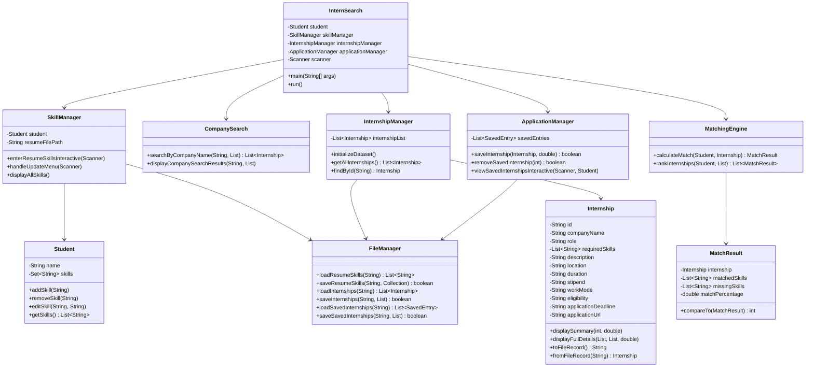

# InternSearch – Smart Internship Discovery & Skill Matching System

> A Core Java console application for college students and freshers to discover technical internships matching their current resume skills, compute accurate match percentages, identify skill gaps, bookmark opportunities, and explore company expectations.

---

## 1. Project Overview

**InternSearch** is an object-oriented Java system developed without external API dependencies or heavy graphical frameworks. It delivers an intuitive, fast, and persistent CLI experience that students can run in any terminal or IDE (such as Visual Studio Code).

### Key Features
1. **Resume Skill Intake:** Comma-separated entry, duplicate prevention, and permanent persistence to `resume.txt`.
2. **Intelligent Match Engine:** Compares student skills with job requirements, computing:
   $$\text{Match Percentage} = \left(\frac{\text{Matched Skills}}{\text{Total Required Skills}}\right) \times 100$$
3. **Descending Ranked Recommendations:** Lists opportunities from highest to lowest match percentage.
4. **Full Internship Inspection:** Displays roles, compensation, locations, work modes, deadlines, application URLs, matched skills, and missing skills.
5. **Skill Management Submenu:** Supports adding, deleting, editing, and listing resume skills with immediate recalculation.
6. **Bookmarking & Saved Internships:** Saves selected opportunities to `saved_internships.txt` with duplicate prevention and deletion capabilities.
7. **Company Discovery Search:** Case-insensitive partial name search allowing students to explore company skill requirements regardless of their current skills.

---

## 2. Project Architecture & Design

### Architectural Layers
- **Presentation Layer (`InternSearch.java`):** Console UI, menu loops, formatted card displays, and robust input validation.
- **Business Logic Layer (`SkillManager`, `InternshipManager`, `MatchingEngine`, `CompanySearch`, `ApplicationManager`):** Skill parsing, duplicate checks, ranking, filtering, and mathematical calculations.
- **Model Layer (`Student`, `Internship`, `MatchResult`):** Encapsulated data models holding candidates, opportunities, and match evaluations.
- **Persistence Layer (`FileManager`):** Resilient text file I/O (`resume.txt`, `internships.txt`, `saved_internships.txt`) with encoding safety and error handling.

### Class Relationship Diagram (Mermaid)


---

## 3. Matching Algorithm Explanation

### Formula
For any candidate profile with skill set $S$ and an internship requirement set $R$:
$$\text{Matched Skills} = \{ s \in R \mid \exists k \in S : \text{normalize}(s) = \text{normalize}(k) \}$$
$$\text{Missing Skills} = R \setminus \text{Matched Skills}$$
$$\text{Match Percentage} = \begin{cases} 
\left(\dfrac{|\text{Matched Skills}|}{|R|}\right) \times 100 & \text{if } |R| > 0 \\
0.0 & \text{if } |R| = 0 
\end{cases}$$

### Edge Cases Handled
1. **Case-Insensitive Matching:** `"java"`, `"Java"`, and `"JAVA"` are treated as identical.
2. **Whitespace Trimming:** Accidental spaces (e.g., `" Python "`) are stripped before matching.
3. **Empty Requirements Safety:** Avoids division by zero if an internship has zero required skills.
4. **Order Independence:** The sequence in which skills are entered does not impact the mathematical intersection.
5. **Secondary Sorting:** If two internships have identical match percentages, they are tie-broken alphabetically by company name.

---

## 4. File Structure

```
InternSearch/
├── InternSearch.java        # Main class and CLI controller
├── Internship.java          # Internship model with formatting and serialization
├── Student.java             # Student model managing unique skills (LinkedHashSet)
├── MatchResult.java         # DTO storing matched skills, missing skills, and score
├── MatchingEngine.java      # Intersection calculation and descending ranking
├── SkillManager.java        # Interactive resume skill entry, edit, and deletion
├── InternshipManager.java   # Dataset manager and fallback sample generator
├── CompanySearch.java       # Standalone company search independent of candidate skills
├── ApplicationManager.java  # Bookmarking controller with duplicate protection
├── FileManager.java         # Defensive file I/O operations (UTF-8)
├── internships.txt          # Pipe-delimited dataset of 15+ industry internships
├── resume.txt               # Persistent storage of candidate skills
├── saved_internships.txt    # Persistent storage of bookmarked internships
└── README.md                # Project documentation and presentation guide
```

---

## 5. Execution Instructions for Visual Studio Code

### Prerequisites
- Java Development Kit (JDK 17 or later) installed.
- VS Code with the "Extension Pack for Java" (recommended, or plain built-in terminal).

### Step-by-Step Run Guide

1. **Open the Project Folder in VS Code:**
   - Launch VS Code.
   - Go to `File` > `Open Folder...` and select `InternSearch`.

2. **Open the Integrated Terminal:**
   - Press ``Ctrl + ` `` (Backtick) or go to `Terminal` > `New Terminal`.

3. **Compile the Application:**
   ```bash
   javac InternSearch.java
   ```
   *(Or compile all files: `javac *.java`)*

4. **Run the Application:**
   ```bash
   java InternSearch
   ```

---

## 6. Comprehensive Test Cases

| Test Case | Feature Tested | Input | Expected Output | Status |
|---|---|---|---|---|
| **TC-01** | Resume Skill Entry | `Java, Python, SQL, Docker` | 4 skills saved to `resume.txt` without duplicates. | PASSED |
| **TC-02** | Duplicate Prevention | `Java, java, JAVA` | 1 skill added (`Java`), 2 duplicates reported and ignored. | PASSED |
| **TC-03** | Empty Input Validation | Press `Enter` (blank) | Validation error: `Input cannot be empty.` No crash. | PASSED |
| **TC-04** | Skill Matching | Find Internships with `Java, Spring Boot, Python, SQL` | Matches JPMorgan Chase at `80.0%` (4/5 skills), lists Docker as missing. | PASSED |
| **TC-05** | Descending Sort | Find Internships | Opportunities sorted strictly from highest match % to lowest. | PASSED |
| **TC-06** | Bookmarking | Select Internship #1, choose `y` | Saved to `saved_internships.txt`. | PASSED |
| **TC-07** | Duplicate Bookmark | Re-save the same internship | Warning displayed: already in saved list. Not duplicated. | PASSED |
| **TC-08** | Resume Skill Update | Edit skill #1 from `Java` to `Core Java` | `resume.txt` updated immediately. Next search reflects new skill name. | PASSED |
| **TC-09** | Company Search | Search query `micro` | Finds `Microsoft Full Stack Developer Intern` regardless of candidate skills. | PASSED |
| **TC-10** | Missing Company | Search query `UnknownCorp` | Displays friendly message: `No internships found...` without crashing. | PASSED |
| **TC-11** | Persistence | Exit app and restart (`java InternSearch`) | All previously entered skills and saved bookmarks auto-loaded from disk. | PASSED |

---

## 7. Viva Questions and Answers

### Q1: Why did you use `LinkedHashSet` in the `Student` class?
**Answer:** A `LinkedHashSet` combines the fast $O(1)$ lookup performance of a hash table with the predictable insertion-order iteration of a linked list. It automatically prevents duplicate skill entries while preserving the chronological order in which the student typed them.

### Q2: How does your matching algorithm handle case differences (e.g., "python" vs "Python")?
**Answer:** In `MatchingEngine.java`, we normalize all skills by trimming extraneous leading/trailing whitespace and converting them to lowercase (`toLowerCase()`) during comparison. When presenting results to the user, the original capitalization defined in the internship dataset is preserved for professional output.

### Q3: How do you prevent division by zero in match percentage calculation?
**Answer:** We check if the total number of required skills (`totalRequired`) is greater than 0 before performing division:
```java
if (totalRequired > 0) {
    percentage = ((double) matchedList.size() / totalRequired) * 100.0;
} else {
    percentage = 0.0;
}
```

### Q4: Why is `Scanner.nextLine()` used instead of `Scanner.nextInt()`?
**Answer:** `Scanner.nextInt()` only consumes numeric tokens, leaving the trailing newline character (`\n`) in the input buffer. Subsequent calls to `Scanner.nextLine()` would immediately read that leftover empty line. By consistently using `Scanner.nextLine().trim()` and parsing with `Integer.parseInt()`, we eliminate input buffer corruption and gracefully handle non-numeric user inputs.

### Q5: How is data persisted when the application is closed?
**Answer:** We use Core Java file handling classes (`BufferedReader`, `BufferedWriter`, `FileInputStream`, and `FileOutputStream`) with `StandardCharsets.UTF_8` in `FileManager.java`. Data is stored in plain text files (`resume.txt`, `internships.txt`, `saved_internships.txt`) using pipe delimiters (`|`), making the records robust and transparent.
